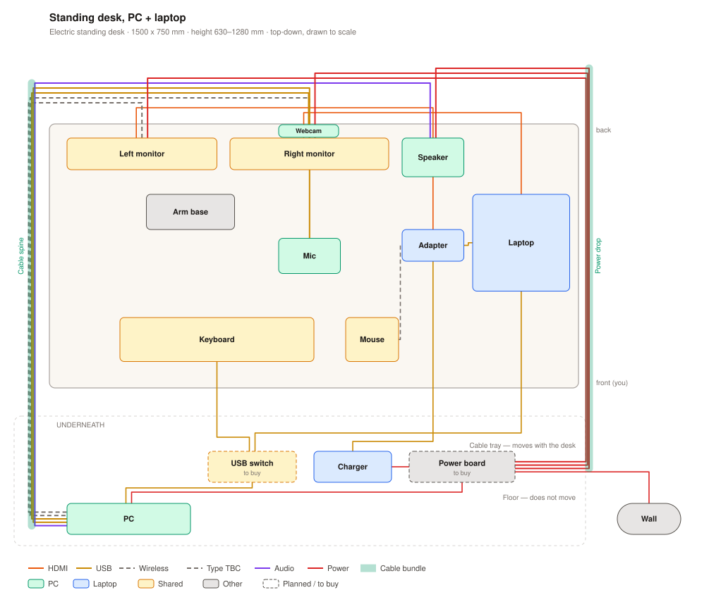

# deskmap

Describe your desk setup in a YAML file: the desk, where each device sits, and every cable between them. deskmap checks the file and draws a to-scale, top-down diagram of it.



It's built for two jobs:

- **Planning cable runs, especially on a standing desk.** deskmap knows which zones move with the desk and which don't, so it lists every cable that has to stretch when the desk goes up, and warns about the ones not routed through a cable spine.
- **Describing your setup to people and AI agents.** A structured file is exact in a way a photo isn't: an agent can answer "what's still plugged into the PC?" or "which cables reach the floor?" from it directly.

## Web app (MVP)

An interactive editor for your desk setup. It runs locally in the browser, with no backend. Your setup autosaves in the browser, and Save downloads it as a YAML file.

```sh
cd web
npm install
npm run dev        # open http://localhost:5173
```

- Zoom and pan the diagram. Drag devices to match where they sit on your desk.
- Ports appear on the side of the device they are physically on. A filled dot has a cable in it; a hollow dot is free.
- Solid lines are cables, coloured by what they carry (power, video, data). Dashed green lines are wireless links.
- Drag from one port to another to plug in a cable. Drag between two green radio dots to pair wireless devices.
- Select a cable and drag its handle to reshape it. Double-click the handle to straighten it.
- Click a device or cable to edit it in the side panel. Delete removes the selection.

### The setup file (`deskmap/0.2`)

The schema lives in [web/src/model/setup.ts](web/src/model/setup.ts). See [examples/macbook-desk.deskmap.yaml](examples/macbook-desk.deskmap.yaml).

```yaml
schema: deskmap/0.2
name: MacBook desk
devices:
  macbook:
    name: MacBook Pro 14
    kind: laptop
    battery: true
    radios: [bluetooth, wifi]
    ports:
      magsafe: { label: MagSafe 3, connector: magsafe, side: left, carries: [power_in] }
      hdmi: { label: HDMI, connector: hdmi, side: right, carries: [video] }
  monitor:
    name: External monitor
    kind: monitor
    ports:
      hdmi_in: { label: HDMI in, connector: hdmi }
  mouse:
    name: Mouse
    kind: mouse
    radios: [bluetooth]
links:
  - { medium: wired, from: macbook.hdmi, to: monitor.hdmi_in, length_m: 1.5 }
  - { medium: wireless, from: mouse, to: macbook, radio: bluetooth }
layout:
  devices:
    macbook: { x: 400, y: 300 }
```

- A **device** is anything with I/O. It has a name and ports, plus optional kind, model, radios and battery.
- A **port** has a connector (its physical shape, like `usb_c` or `hdmi`), the side of the device it is on, and optionally what it carries (`data`, `video`, `audio`, `power_in`, `power_out`). Shape and capability are kept apart because a USB-C port can be anything from charge-only to Thunderbolt.
- A **link** is either `wired` (a cable from one port to another) or `wireless` (two devices paired over a radio). A cable always plugs into ports, so a wired link names `device.port` on both ends.
- **Layout** (where things sit in the diagram) is kept separate from what the setup is, so you can rearrange without changing the setup.

The app also accepts the same structure as JSON.

## Python CLI (`deskmap/0.1`)

The original command-line tool still reads the older `deskmap/0.1` format below. The web app does not read that format.

## Quick start

```sh
pip install deskmap            # or: pip install -e . from a clone
deskmap check examples/standing-desk-pc-and-laptop.yaml
deskmap render examples/standing-desk-pc-and-laptop.yaml   # writes the .svg next to it
```

`check` validates the file and prints the stretch report:

```
examples/standing-desk-pc-and-laptop.yaml: 15 devices, 19 cables, 0 errors, 3 warnings
  warning: cables[7] (pc -> monitor_left): cable type not set yet
  warning: cables[8] (pc -> monitor_right): cable type not set yet
  warning: cables[18] (power_board -> wall): runs between the moving desk and a static zone without a spine; it needs at least 650 mm of slack

Cables between the moving desk and something static (desk travels 650 mm):
  pc -> monitor_left (type not set) — via spine
  ...
  power_board -> wall (power) — NOT via a spine
```

`check --strict` exits non-zero on warnings too, which is handy in CI.

## Writing a setup file

The smallest useful file ([examples/minimal.yaml](examples/minimal.yaml)):

```yaml
# yaml-language-server: $schema=../deskmap/schema.json
schema_version: "0.1"
name: Laptop + one monitor

desk:
  size_mm: { width: 1200, depth: 600 }

devices:
  laptop:
    kind: laptop
    zone: desk
    position: { x: 820, y: 280, w: 320, d: 230 }
  monitor:
    kind: display
    zone: desk
    used_by: [laptop]
    position: { x: 300, y: 40, w: 600, d: 90 }
  power_board:
    kind: power
    zone: tray
    position: { x: 500, w: 300 }

cables:
  - { from: laptop, to: monitor, type: usb_c }
  - { from: monitor, to: power_board, type: power }
  - { from: laptop, to: power_board, type: power }
```

**Editor support:** the first-line comment points the [YAML extension for VS Code](https://marketplace.visualstudio.com/items?itemName=redhat.vscode-yaml) (and other editors using yaml-language-server) at the schema, which gives you autocomplete, hover docs and errors as you type.

### The format at a glance

All distances are millimetres. The full definition is [deskmap/schema.json](deskmap/schema.json).

| Section | What it holds |
|---|---|
| `desk` | `size_mm` (required), `model`, `height_range_mm: [low, high]` for a standing desk |
| `zones` | Where things live. Each has a `kind` (`surface`, `underneath`, `external`) and `moves_with_desk`. Leave it out to get the defaults: `desk`, `tray` (moves), `floor` (static), `wall` |
| `channels` | Named cable routes: `edge` (along the back of the desk) or `spine` (a vertical drop at `x_mm`; negative is off the left side, beyond the desk width is off the right) |
| `devices` | Keyed by id. `zone` is required; also `label`, `kind`, `position`, `used_by`, `model`, `ports`, `status` (`owned`, `planned`, `to_buy`), `color`, `notes` |
| `cables` | `from` and `to` (a device id, optionally with a port: `laptop.hdmi`), `type`, `via` (channel ids), `length_m`, `status`, `note` |

**Positions.** On the desk, `x`/`y` are measured from the desk's back-left corner, with `y` growing toward you; `w` and `d` are width and depth. Underneath and external devices only need `x` and `w`; each underneath zone is drawn as a row below the desk.

**Colours.** Each `computer` or `laptop` gets its own colour. A device with one entry in `used_by` takes that computer's colour; two or more and it's drawn as shared. Everything else is grey.

**Cable types:** `hdmi`, `displayport`, `usb_a`, `usb_c`, `thunderbolt`, `audio`, `power`, `ethernet`, `wireless`, `other`. Leave `type` out if you don't know yet; it's drawn dashed and flagged by `check`.

### How cables are drawn

| Cable | Route |
|---|---|
| Desk to desk, with `via` | Up to the back edge, along it, and down to the other device |
| Desk to desk, no `via` | Straight across |
| Desk to underneath, via a spine | Along the back edge to the spine, down it, then across to the device |
| Desk to underneath, no `via` | Straight down into the row |
| Underneath / external | Across or between the rows |

Hover a cable in the SVG to see its endpoints, type, route and note.

### Gotcha: commas inside `{ }`

In YAML flow style, `{ note: DP or HDMI, at least 2 m }` is read as two keys. Quote any value with a comma: `note: "DP or HDMI, at least 2 m"`. deskmap rejects the stray key and tells you to check for this.

## What it checks

- **Structure** (from the schema): required fields, allowed values, ids, and no unknown keys.
- **References:** every cable endpoint, `via` channel, `zone` and `used_by` entry exists.
- **Layout:** devices on the desk have a full position and fit on it.
- **Standing-desk stretch:** cables joining something that moves with the desk to something that doesn't. Each one is flagged if it isn't routed via a spine, or if its `length_m` is shorter than the desk's travel.

## Development

```sh
pip install -e ".[dev]"
pytest
```

Use it as a library too:

```python
import deskmap
setup = deskmap.load("my-desk.yaml")
print(setup.errors, setup.warnings)
svg = deskmap.render(setup)
```

## Limitations and ideas

- Routing is deliberately simple; busy setups get some overlapping lines.
- `via` order is ignored in v0.1.
- Not yet: a side elevation view, multiple desks, cable bundling, a web editor, exporting a shopping list from `status: to_buy`.

## Prior art

[WireViz](https://github.com/wireviz/WireViz) turns YAML into wiring-harness diagrams at the connector-and-pin level. deskmap is about the physical layout of a desk and where cables run around it.

## License

MIT
